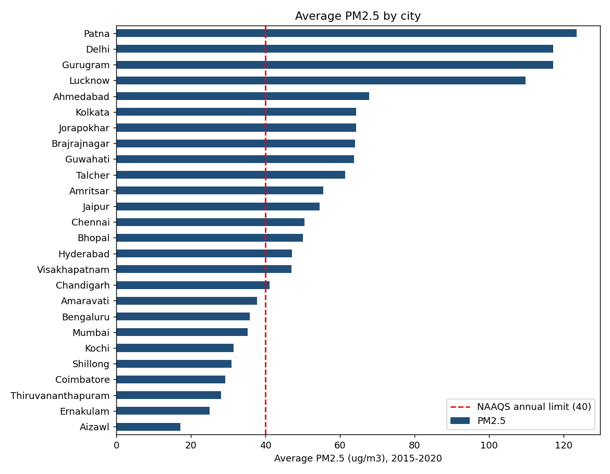
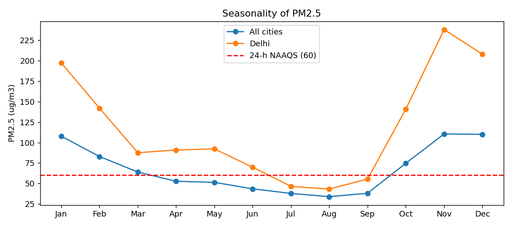
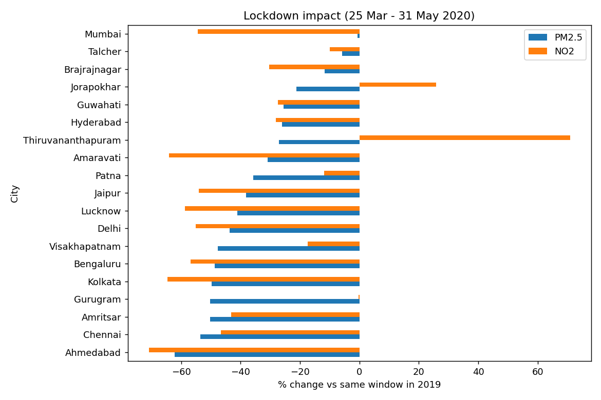

# India Urban Air Quality Analysis (2015–2020)

Exploratory analysis and Excel dashboard of daily air-quality readings from **26 Indian cities** (Central Pollution Control Board data), focused on the combustion-linked pollutants that emission norms target: **PM2.5 and NO2**.

**Tools:** Python (pandas, Matplotlib) for cleaning · MS Excel (AVERAGEIFS, COUNTIFS, INDEX-MATCH, RANK, charts) for the dashboard

## Business questions
1. Which cities have the worst particulate pollution, and how often do they breach the national standard?
2. How strongly does pollution depend on season?
3. What happened to pollution when traffic, industry and generators largely stopped during the 2020 lockdown? (A natural experiment on how much combustion sources contribute.)

## Data
| Item | Detail |
|---|---|
| Source | CPCB daily city data, compiled as *Air Quality Data in India (2015–2020)* (Kaggle) — `data/raw/city_day.csv` |
| Size | 29,531 city-day records · 26 cities · 1 Jan 2015 – 1 Jul 2020 · 16 columns |
| Quality | No duplicate city-days; no negative values; 15.6% of PM2.5 and 12.1% of NO2 readings missing |

**Cleaning choices:** missing readings were left blank rather than imputed, so every average uses only days a station actually reported. Each record was tagged with year, month and IMD season. Because cities joined the network at different times (9 in 2015 → 26 by 2020), all-city yearly averages are not compared — comparisons are within the same city or the same date window.

## Key insights
| Metric | Result |
|---|---|
| Most polluted cities (avg PM2.5) | Patna 123.5, Delhi 117.2, Gurugram 117.1, Lucknow 109.7 µg/m³ — **2.7–3.1× the annual NAAQS of 40** |
| Days breaching the 24-h PM2.5 limit (60 µg/m³) | **39.0%** of all city-days; **72.5%** of days in Delhi |
| Days rated AQI "Poor" or worse | **26.0%** |
| Seasonality | Winter PM2.5 is **2.6×** monsoon levels (100.2 vs 38.6 µg/m³) |
| 2020 lockdown vs same window in 2019 (25 Mar – 31 May) | PM2.5 **−37.7%** (all 19 cities improved) · NO2 **−43.4%** (17 of 19 cities improved) |

**Takeaway:** the sharp lockdown drop in NO2 — a pollutant that comes mainly from fuel combustion in vehicles, generators and industry — shows how large a share of urban pollution these sources drive, which is the market case for emission-control technology in the high-burden north Indian cities.





## Dashboard (`output/India_AQI_Dashboard.xlsx`)
| Sheet | What it shows |
|---|---|
| Dashboard | 9 KPI tiles + city ranking, monthly trend and lockdown charts |
| City_Ranking | Avg PM2.5 / NO2 / AQI, days above NAAQS and rank for each city |
| Seasonality | Monthly and seasonal averages, all cities vs Delhi |
| Lockdown_Impact | City-by-city change in PM2.5 and NO2, 2020 lockdown vs 2019 |
| Data | 29,531 cleaned daily records (filterable) |
| Notes | Source, definitions and input cells (blue) — change the NAAQS limit or date windows and every sheet recalculates |

All ~29,900 summary cells are live formulas, not pasted numbers. The Excel results were cross-checked against pandas and match exactly.

## Reproduce
```bash
pip install pandas matplotlib openpyxl
python analysis.py
```
Open the workbook in Excel (or upload to Google Sheets); formulas calculate on open.
